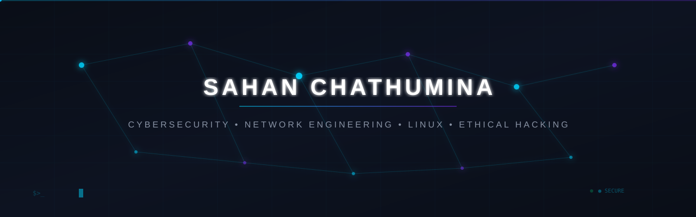

<div align="center">



</div>

<div align="center">

<a href="https://github.com/Sahan-Chathumina-25">
  
</a>

<br/>


</div>

---

## $ whoami

Hi, I'm **Sahan Chathumina** — `Sahan-Chathumina-25` on GitHub. I'm a WordPress-focused Full Stack Web Developer and a student of Ethical Hacking & Network Security at NIBM. I build websites and small tools while developing practical skills in networking, Linux systems, and security.

```text
name      : Sahan Chathumina
handle    : Sahan-Chathumina-25
role      : WordPress Full Stack Web Developer
interests : Networking and Cybersecurity
base      : Sri Lanka
education : BSc (Hons) in Ethical Hacking & Network Security - NIBM
status    : building projects and learning in public
```

---

## Philosophy

> Understand the system, build something small, verify what you learned.

I learn by doing: labs, projects, and notes that record both what worked and what didn't.

---

## Technical Skills

<div align="center">


</div>

- **Web Development** — WordPress, HTML, CSS, JavaScript, PHP, MySQL, Laravel, Full Stack Development
- **Networking & Systems** — Computer Networking, TCP/IP, DNS and DHCP, Linux Administration, Network Configuration, Cisco Networking, Server Administration
- **Cybersecurity** — Ethical Hacking, Network Security, Vulnerability Research, Linux Security, Web Application Security, Security Testing, Source Code Analysis

---

## Featured Projects

Small projects built while learning. Details and source are in the linked repositories.

| Project | Description | Stack |
|---|---|---|
| [**Security Researches**](https://github.com/Sahan-Chathumina-25/Security-Researches) | Local source-code audits of open-source projects, with verification notes and redacted reports. | `Linux` `Python` `Jekyll` |
| [**Sahan Frontend**](https://github.com/Sahan-Chathumina-25/Sahan-Frontend) | Next.js portfolio frontend with a responsive, dark engineering-styled interface. | `Next.js` `TypeScript` `React` `Tailwind` |
| [**Sahan Backend**](https://github.com/Sahan-Chathumina-25/Sahan-Backend) | TypeScript backend API for the portfolio, with contact handling and rate limiting. | `TypeScript` `Express` `MongoDB` `Cloudflare Workers` |
| [**Bulk Download Manager**](https://github.com/Sahan-Chathumina-25/Bulk_Download_Manager) | Native Rust desktop download manager with a graphical interface. | `Rust` `egui` `Tokio` `SQLite` |
| [**README Automation**](https://github.com/Sahan-Chathumina-25/github-readme-automation) | Tool that generates and validates a GitHub profile README from configuration. | `TypeScript` `Node.js` `GitHub API` |

---

## Learning & Research

**Completed and documented locally**

- Source-code audits of open-source projects (PHP, OpenSSL, OpenSSH, xrdp, and Node.js), with reproducible verification notes in the [Security Researches](https://github.com/Sahan-Chathumina-25/Security-Researches) repository.
- Public reports are redacted, and no finding has been submitted to a vendor or published as an advisory.

**Ongoing**

- Refining analysis notes and preparing responsible-disclosure reports.
- Practising web application and network security in personal labs.
- Working through Linux administration, networking, and hardening topics.

---

## GitHub Statistics

<div align="center">




</div>

---

## Currently Learning

- WordPress theme and plugin development
- PHP, MySQL, and Laravel fundamentals
- Linux administration and network configuration
- Web application and network security testing

---

## Future Goals

- Build and document more WordPress and full-stack web applications.
- Strengthen networking and Linux administration skills through hands-on labs.
- Continue responsible security research with clear, verified write-ups.
- Contribute small fixes to open-source projects.

---

## Contact

<div align="center">

[](https://github.com/Sahan-Chathumina-25)
[](https://sahancs.is-a.dev/)
[](https://research.sahancs.is-a.dev/)

</div>

---

## Ethical Use

> All security testing and research shown here is performed on systems I own, in personal labs, or where I have explicit permission. Nothing here supports unauthorized access; findings are handled through responsible disclosure with sensitive details withheld.
